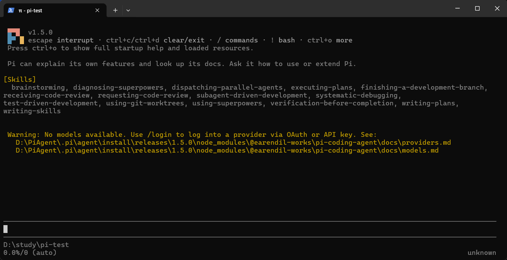
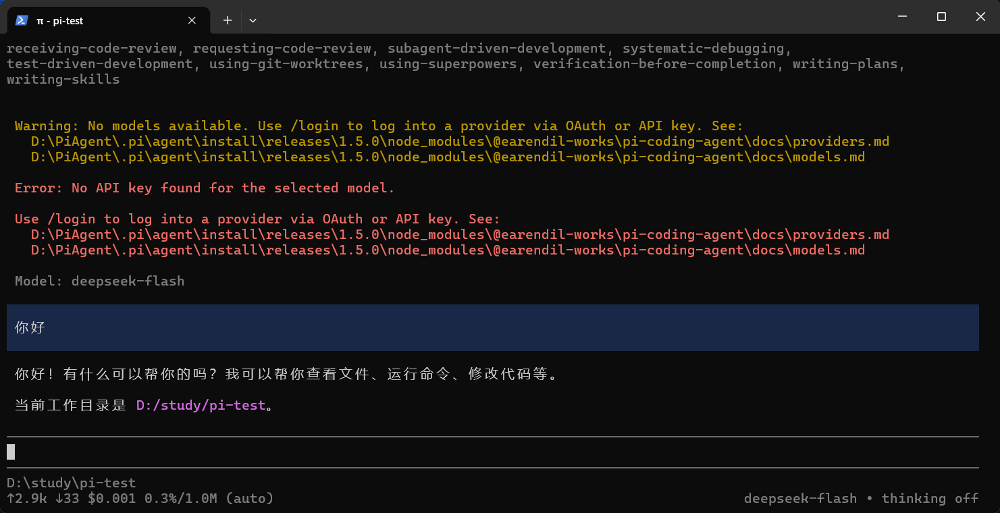
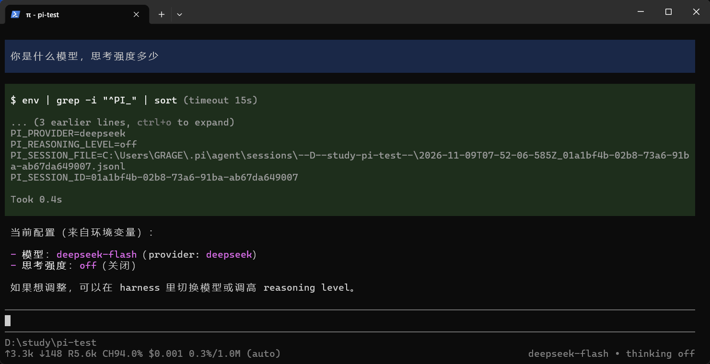
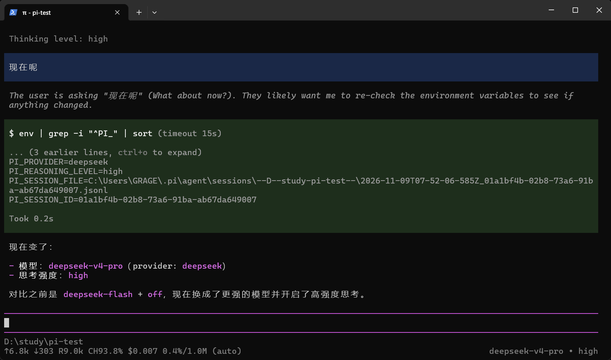
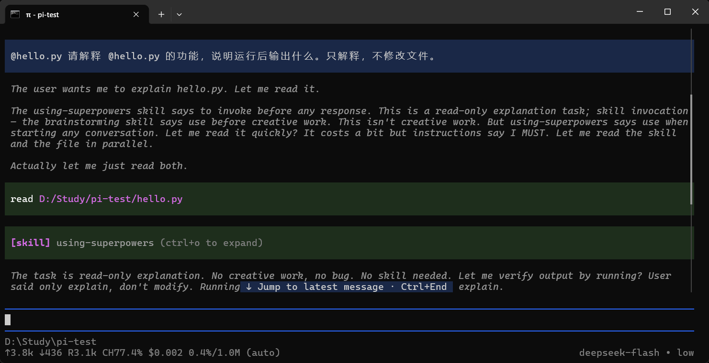
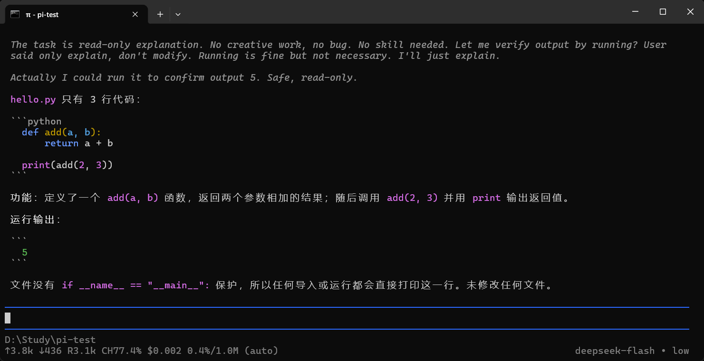
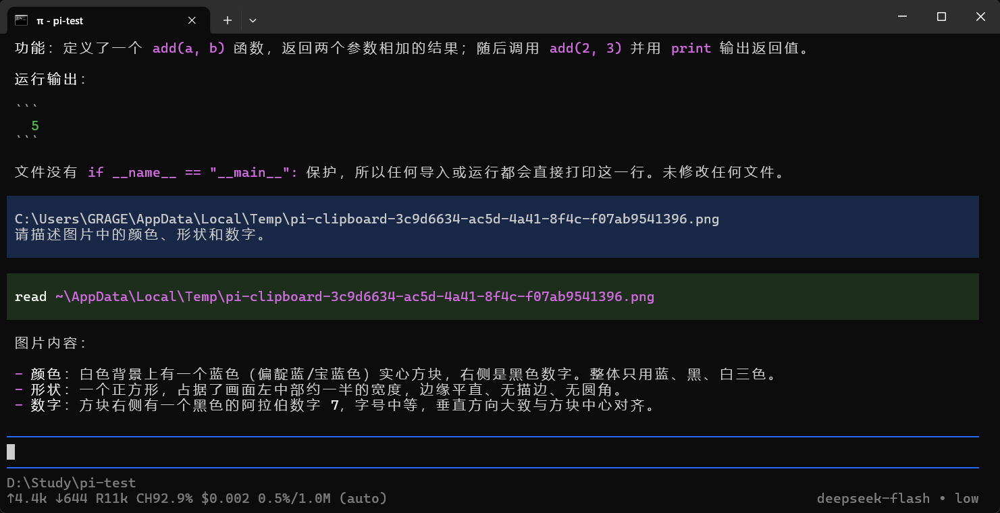
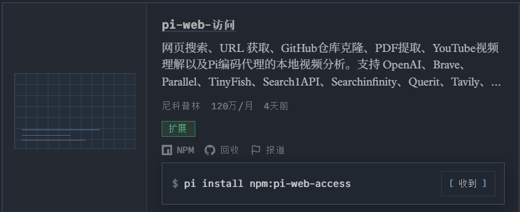
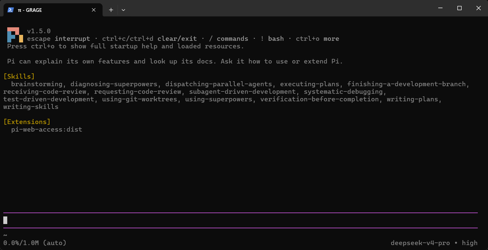
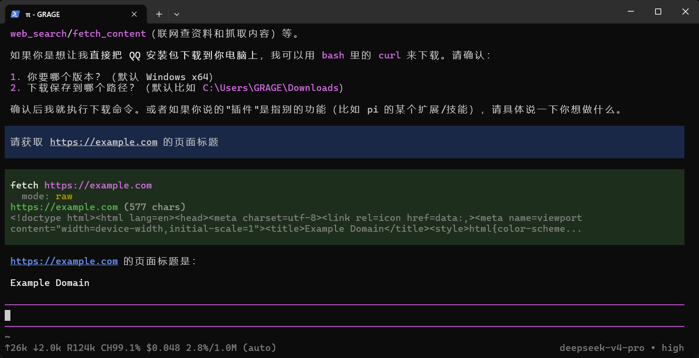

# 实践课 1：Pi Agent 安装与基础使用报告

- **姓名拼音**：`liushangkun`
- **Issue 标题**：`实践课1： Pi Agent安装与使用 liushangkun`
- **本机环境**：Windows / PowerShell，Node.js `v24.15.0`，npm `12.2.0`，Git `2.54.0.windows.1`
- **已安装 Pi 版本**：`v1.5.0`（安装路径：`D:\PiAgent\.pi\agent\install\releases\1.5.0\...`）
- **练习目录**：`D:\study\pi-test`

---

## 任务一：本地安装并启动 Pi

### 操作步骤
1. 在 PowerShell 中通过官方安装脚本完成 Pi 客户端安装：
   ```powershell
   powershell -c "irm https://pi.dev/install.ps1 | iex"
   ```
2. 重新打开 PowerShell，在练习目录 `D:\study\pi-test` 中启动 Pi：
   ```powershell
   mkdir pi-test
   cd pi-test
   pi
   ```
3. 说明：本次安装的是 Pi 命令行客户端（CLI），并非在本地部署大模型权重；首次启动提示 `Warning: No models available`，且左下角显示工作目录 `D:\study\pi-test`、顶部显示版本 `v1.5.0`，说明客户端安装并启动成功。

### 截图 S1（安装成功并启动 Pi）



---

## 任务二：配置模型并完成一次会话

### 操作步骤
1. 在 Pi 交互界面中输入 `/login`，选择 **Sign in with an API key**，配置 DeepSeek API Key（不提交 `auth.json`、完整密钥或授权回调链接）。
2. 配置完成后选择模型 `deepseek-flash`，发送最简单的测试提示词 `你好`。
3. 收到模型正常回复，底部状态栏显示 `deepseek-flash • thinking off`。

### 截图 S2（配置模型并完成首次会话）



---

## 任务三：切换模型与模型思考级别

### 切换记录
- **切换前**：模型 `deepseek-flash`（provider: `deepseek`），思考级别 `off`（底部状态栏显示 `deepseek-flash • thinking off`，环境变量 `PI_REASONING_LEVEL=off`）。
- **切换后**：模型 `deepseek-v4-pro`（provider: `deepseek`），思考级别 `high`（界面提示 `Thinking level: high`，底部状态栏显示 `deepseek-v4-pro • high`，环境变量 `PI_REASONING_LEVEL=high`）。
- 切换后继续发送短问题“现在呢”，确认新模型与高思考级别均正常工作。

### 任务复杂度如何影响选择
- 思考级别调整的是模型的内部推理预算，而非更换模型或单纯控制思考文本是否显示。
- 对于简单问答、格式转换、单文件解释等低复杂度任务，使用 `deepseek-flash` 搭配较低思考级别（如 `off` / `low`）可显著减少等待延迟与 Token 消耗；
- 对于复杂架构分析、多文件调试、边界条件排查等高复杂度任务，切换更强模型（如 `deepseek-v4-pro`）并提高思考级别（如 `high`）有助于减少漏步和逻辑错误，但耗时与用量也会相应增加。

### 截图 S3（模型与思考级别切换前后对比）

**切换前（`deepseek-flash` + `off`）：**



**切换后（`deepseek-v4-pro` + `high`）：**



---

## 任务四：使用 `@` 引用代码文件并粘贴小图片测试

### A. 使用 `@` 引用代码文件
1. 在 `D:\study\pi-test` 中创建 `hello.py`：
   ```python
   def add(a, b):
       return a + b

   print(add(2, 3))
   ```
2. 在 Pi 中输入 `@` 并选中 `hello.py`，发送提示词：
   ```text
   @hello.py 请解释 @hello.py 的功能，说明运行后输出什么。只解释，不修改文件。
   ```
3. 核对结果：Pi 调用 `read` 工具读取 `D:/Study/pi-test/hello.py`，准确解释了 `add(a, b)` 的相加功能，给出运行输出 `5`，且未修改任何文件。

### 截图 S4（`@hello.py` 引用与回复）





### B. 粘贴小图片并测试
1. 准备约 200×200 像素的测试图片（白底，左侧为一个蓝色实心正方形，右侧为黑色数字 `7`），复制到剪贴板。
2. 在 Pi 输入区按 `Alt+V`（或 `Ctrl+V`）粘贴图片（Pi 自动保存为临时剪贴板图片 `pi-clipboard-*.png`），发送提示词：
   ```text
   请描述图片中的颜色、形状和数字。
   ```
3. 核对结果：模型准确识别出白色背景上的蓝色实心正方形及右侧黑色数字 `7`。

### 截图 S5（原始小图片与粘贴识别结果）

**原始测试小图：**


**粘贴图片与模型识别结果：**



---

## 任务五：从 Pi Packages 自选并安装使用一个插件

### 所选插件信息
- **插件名称**：`pi-web-access`
- **来源**：Pi Packages（https://pi.dev/packages） / npm 包 `npm:pi-web-access`
- **安装命令**：
  ```powershell
  pi install npm:pi-web-access
  ```
- **作用**：提供网页搜索、URL 抓取（`fetch` / `fetch_content`）、PDF 提取等联网扩展工具。
- **安装来源核对**（`pi list` 实测输出）：
  ```text
  User packages:
    npm:pi-web-access
      C:\Users\GRAGE\.pi\agent\npm\node_modules\pi-web-access
  ```

### 验证过程与结果
1. **插件加载成功**：安装后退出原会话并重新执行 `pi`，启动界面的 `[Extensions]` 区域清楚显示 `pi-web-access:dist`。
2. **联网功能可用**：发送测试提示词 `请获取 https://example.com 的页面标题`，Pi 成功调用 `fetch https://example.com`，返回原始 HTML 并准确提取出页面标题 **`Example Domain`**。

### 截图 S6（插件来源、重启加载与功能调用）

**插件目录与安装命令来源：**



**重启 Pi 后 `[Extensions]` 加载成功：**



**最小功能试用（获取 `https://example.com` 页面标题）：**



> 可选补图提示：如老师严格检查 S6 的“终端安装成功输出”，可在 PowerShell 中运行 `pi list`（或再执行一次 `pi install npm:pi-web-access`）补截 1 张终端图贴在此处。

---

## 任务六（选做）：让 AI 安装 PPT Skill

本项为选做项，当前作业已完整完成全部必做任务（任务一至任务五）。
