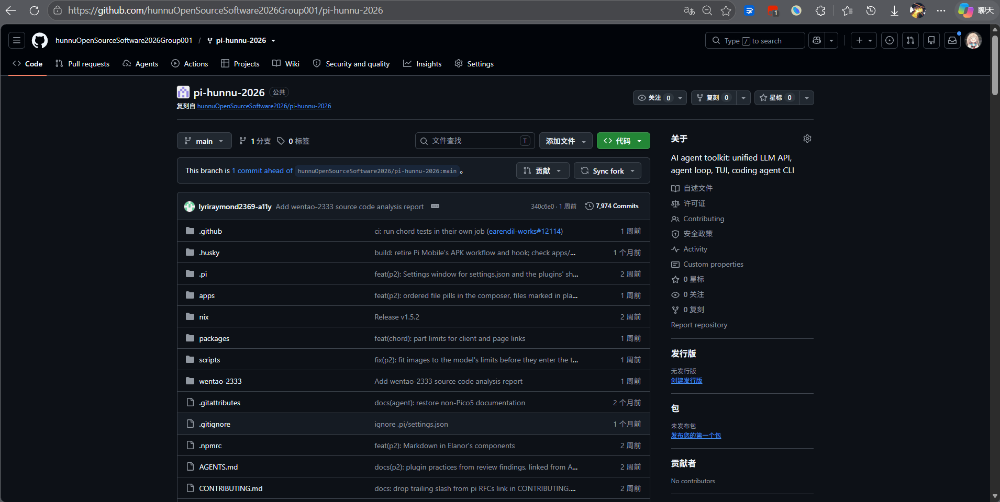
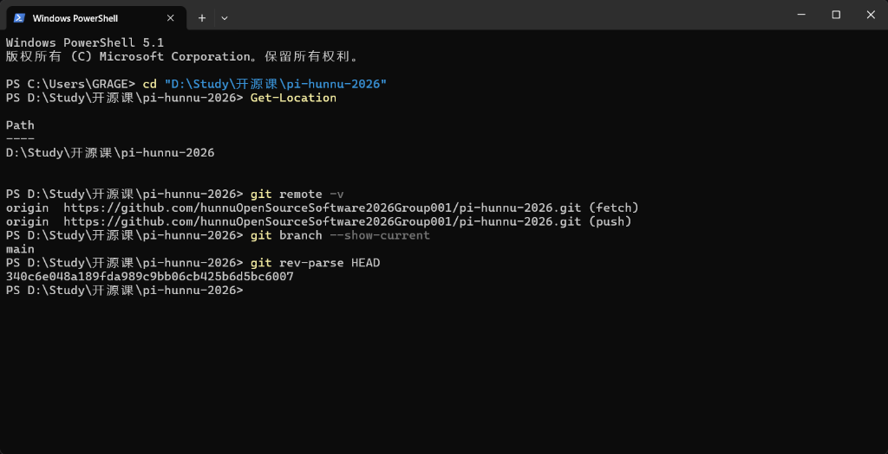
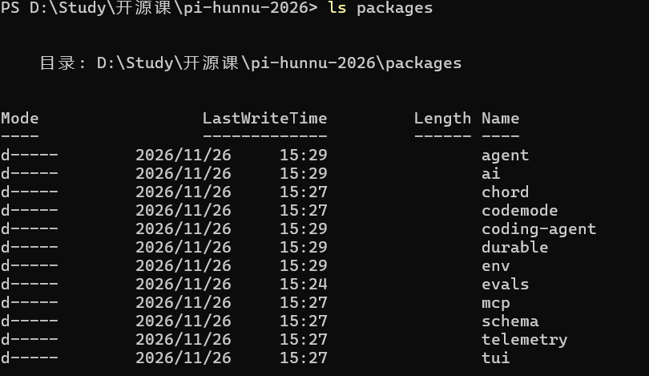
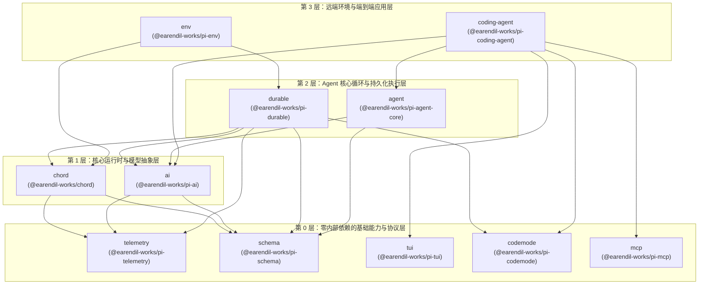

# 实践课 2：小组组织建仓与 Pi Agent 源码阅读报告

- **姓名拼音**：`liushangkun`
- **Issue 标题**：`实践课2：组织建仓与源码分析 liushangkun`
- **小组组织代码仓库地址**：`https://github.com/hunnuOpenSourceSoftware2026Group001/pi-hunnu-2026`
- **实际 Clone 地址**：`https://github.com/hunnuOpenSourceSoftware2026Group001/pi-hunnu-2026.git`
- **本人重点分析模块**：`ai`、`agent`、`coding-agent`、`durable`（其余 7 个模块亦已逐一对照 `package.json` 与 `src/` 核实）

---

## 一、源码获取与版本核对

### 1. 小组仓库 Fork 确认
- 课程上游仓库：`https://github.com/hunnuOpenSourceSoftware2026/pi-hunnu-2026`
- 小组组织仓库：`https://github.com/hunnuOpenSourceSoftware2026Group001/pi-hunnu-2026`



### 2. 本地 Clone 与版本信息
在本地工作目录执行克隆并核对仓库来源、分支与提交号：

```powershell
git clone --branch main https://github.com/hunnuOpenSourceSoftware2026Group001/pi-hunnu-2026.git
cd pi-hunnu-2026
Get-Location
git remote -v
git branch --show-current
git rev-parse HEAD
git status --short
```

核对结果（实测记录）：
- **当前目录**：`D:\Study\开源课\pi-hunnu-2026`
- **远端 `origin`**：`https://github.com/hunnuOpenSourceSoftware2026Group001/pi-hunnu-2026.git`（fetch / push 均指向小组组织仓库）
- **当前分支**：`main`
- **完整提交编号（HEAD）**：`340c6e048a189fda989c9bb06cb425b6d5bc6007`
- **工作区状态**：克隆后干净（无未提交修改）

**本地仓库元信息核对（目录、远端地址、分支、HEAD 提交号）：**



**源码 `packages/` 目录结构：**



---

## 二、根目录构建顺序与目录差异说明

查看根 [package.json](file:///d:/Study/开源课/pi-hunnu-2026/package.json) 的 `scripts.build`，实际按以下顺序依次串联编译 **11 个子模块**：

```text
telemetry → schema → chord → tui → codemode → mcp → ai → durable → env → agent → coding-agent
```

**版本差异核实**：
本地 `packages/` 目录下共有 **12 个** 子文件夹，除上述 11 个外还多出一个 `packages/evals`（包名 `@earendil-works/pi-evals`，`"private": true`）。经核查 `packages/evals/package.json`，它**没有 `build` 脚本**，也**不在根目录 `scripts.build` 中**；它是内部评测框架，通过根脚本 `npm run eval` 直接以 `node --experimental-strip-types` 和 `vitest` 运行，用于评测 `@earendil-works/pi-ai` 和 `@earendil-works/pi-coding-agent`（两者位于其 `devDependencies`）。

---

## 三、11 个子模块功能与依赖分析表

下表全部依据本机克隆仓库（提交 `340c6e048a189fda989c9bb06cb425b6d5bc6007`）各模块的 `package.json`、`tsconfig.build.json` 与 `src/` 源码核实。所有子包均继承根 `tsconfig.base.json`（开启 `declaration`、`declarationMap`、`sourceMap`，`rootDir: "./src"`，`outDir: "./dist"`），且 11 个子包的 `devDependencies` / `peerDependencies` / `optionalDependencies` 中均**不包含**内部工作区包依赖（内部依赖全部声明在 `dependencies` 中）。

| 子文件夹 | 代码主要实现什么功能 | 本模块 build 执行什么、生成什么 | 直接依赖哪些内部模块 | 依据文件或代码位置 |
|---|---|---|---|---|
| `telemetry` | 厂商无关的遥测、链路追踪与指标抽象：定义 `TelemetryContext` / `TelemetrySpan` / `TelemetryStore`、`defineTelemetrySchema` 类型安全埋点、空实现 `NOOP_TELEMETRY_CONTEXT`、内存收集器与追踪渲染器 | `tsc -p tsconfig.build.json`；生成 `dist/index.{js,d.ts}`、`dist/render.{js,d.ts}`、`dist/testing/index.{js,d.ts}` 及 source map | 无 | `packages/telemetry/package.json`、`packages/telemetry/src/index.ts`、`src/metrics.ts` |
| `schema` | 不依赖 `eval`、兼容 CSP 的 JSON Schema（Draft 2020-12 / Draft 7）校验器：提供流式 Schema 构建器（`obj`/`str`/`arr` 等）、闭包编译器、`$ref` 解析、类型强制转换、错误解释与格式校验 | `tsc -p tsconfig.build.json`；生成 `dist/index.{js,d.ts}`、`dist/formats/index.{js,d.ts}` 及映射文件 | 无 | `packages/schema/package.json`、`packages/schema/src/index.ts`、`src/compiler.ts` |
| `chord` | 跨进程对象与状态同步运行时：包含 Schema 校验契约、响应式状态与增量 Delta、版本化文档、Node/Cloudflare SQLite 存储、后台任务、RPC/IPC/WebSocket 链路、同步引擎、Node 插件宿主及 Web/React/TUI 接入层 | `tsc -p tsconfig.build.json`；生成 `dist/index.{js,d.ts}` 及 25 个子路径导出（`sqlite/*`、`node/*`、`sync`、`web`、`react`、`tui` 等） | `schema`（`@earendil-works/pi-schema`）、`telemetry`（`@earendil-works/pi-telemetry`） | `packages/chord/package.json`（L172-175）、`packages/chord/src/index.ts` |
| `tui` | 差分渲染终端 UI 框架：提供主屏/备屏渲染器、`ProcessTerminal`、Kitty 键盘协议与快捷键绑定、布局引擎、OKLab 色彩、模糊补全、终端内联图片、原生剪贴板绑定，以及 `Editor`/`Markdown`/`SelectList`/`ScrollView` 等组件 | `tsc -p tsconfig.build.json`（另有按平台单独执行的原生插件脚本 `build:native:*`）；生成 `dist/index.{js,d.ts}` 及 `dist/**/*.js`（附带 `native/*/prebuilds/` 预编译 `.node`） | 无 | `packages/tui/package.json`、`packages/tui/src/index.ts`、`src/tui.ts` |
| `codemode` | 基于 `quickjs-wasi`（WASM）的受限 JavaScript 沙箱：代码在沙箱内仅能调用宿主注入的工具；包含本地/内联/Worker 线程/远端沙箱宿主、从 JSON Schema 生成 `.d.ts` 声明、源码解析与 Cloudflare Worker 适配 | `tsc -p tsconfig.build.json`；生成 `dist/{index,declarations,source,portable,cloudflare}.{js,d.ts}` 与 `dist/runtime/worker.{js,d.ts}` | 无 | `packages/codemode/package.json`、`packages/codemode/src/index.ts`、`src/runtime/host.ts` |
| `mcp` | 独立的 Model Context Protocol（MCP）客户端：实现 `McpClient`、JSON-RPC 2.0 协议与内容转换、`Stdio`/`StreamableHttp`/`Pipe`/`InMemory` 四种传输层、OAuth 2.1 PKCE 登录流程、工具命名/Schema 规范化与输出字节截断 | `tsc -p tsconfig.build.json`；生成 `dist/index.{js,d.ts}`、`dist/oauth/index.{js,d.ts}`、`dist/testing/index.{js,d.ts}` | 无 | `packages/mcp/package.json`、`packages/mcp/src/index.ts`、`src/client.ts` |
| `ai` | 统一多厂商 LLM API、模型目录与鉴权层：提供 `Models` 注册表和 `stream`/`streamSimple`/`completeSimple` 统一接口，封装 Anthropic、OpenAI、Google、Bedrock、Mistral 等 30+ 提供商流式适配器、OAuth/密钥存储、`EventStream` 与流式 JSON 参数校验 | `build`: `npm run generate-models && npm run build:offline`（先联网运行 `node catalog/generate.ts --strict` 生成模型目录，再校验数据、`tsc -p tsconfig.build.json` 编译并复制 `src/providers/data` 到 `dist/providers/data`）；生成 `dist/{index,models,api/*,providers/*,cli}.{js,d.ts}` 及 JSON 模型数据 | `schema`（`@earendil-works/pi-schema`）、`telemetry`（`@earendil-works/pi-telemetry`） | `packages/ai/package.json`（L63-92）、`packages/ai/src/models.ts`、`packages/ai/src/api/` |
| `durable` | 持久化对话、任务图与文档执行运行时：实现 `Harness`、生成/工具/压缩任务调度、`TaskGraph`、`LiveDoc`、事务型会话分叉持久化、Memory/IndexedDB/JSONL/Chord/SQLite 多后端存储、执行环境抽象及内置文件/Bash/图片工具 | `tsc -p tsconfig.build.json`；生成 `dist/index.{js,d.ts}` 及 18 个子路径入口（`env/*`、`codemode`、`tools`、`storage/*`、`testing` 等） | `chord`、`ai`、`codemode`、`schema`、`telemetry` | `packages/durable/package.json`（L166-174）、`packages/durable/src/index.ts` |
| `env` | 面向 `durable` 的远端执行环境实现：通过 SSH 部署并连接 Rust 守护进程 `pi-env`，提供 `RemoteExecutionEnv`、`LocalExecutionEnv`、远端管道进程、远端 PTY 终端和文件系统监听 | `tsc -p tsconfig.build.json`（Rust 守护进程另由 `build:daemon` 的 `cargo build` 构建，仓库已带跨平台预编译 `bin/`）；生成 `dist/index.{js,d.ts}` | `chord`（`@earendil-works/chord`）、`durable`（`@earendil-works/pi-durable`） | `packages/env/package.json`（L24-50）、`packages/env/src/index.ts`、`packages/env/README.md` |
| `agent` | 通用有状态 Agent 核心与工具调用循环：实现 `Agent` 状态机（消息历史、steering/follow-up 队列、中止控制、事件分发）和底层 `agentLoop`/`runLoop`/`streamAssistantResponse`/`executeToolCalls`（支持并行与串行工具执行） | `tsc -p tsconfig.build.json`；生成 `dist/{index,agent,agent-loop,proxy,stream-fn,types}.{js,d.ts}` | `ai`（`@earendil-works/pi-ai`）、`schema`（`@earendil-works/pi-schema`） | `packages/agent/package.json`（L25-28）、`packages/agent/src/agent.ts`、`src/agent-loop.ts` |
| `coding-agent` | 面向最终用户的编程 Agent CLI、TUI 与 SDK：包含命令行解析、`AgentSession`/`SessionManager`（JSONL 树持久化与压缩）、内置编程工具（`read`/`bash`/`edit`/`write`/`grep`/`find`/`ls`）、内置扩展（`codemode`/`mcp`/`tool-search`）以及交互/打印/RPC 三种运行模式 | `npm run build:unbundled && node ../../scripts/build-coding-agent-bundle.mjs`：先 `tsc` 编译、标记 `dist/cli.js` 可执行、复制主题/图片/HTML 导出模板资源，再用 `esbuild` 打包生成 `dist/bundle/cli.js`（`bin.pi` 入口）、`cli-runtime.js`、`index.js`、`rpc-entry.js` 与懒加载 chunk（共 84 个文件） | `agent`（`@earendil-works/pi-agent-core`）、`ai`（`@earendil-works/pi-ai`）、`codemode`（`@earendil-works/pi-codemode`）、`mcp`（`@earendil-works/pi-mcp`）、`tui`（`@earendil-works/pi-tui`） | `packages/coding-agent/package.json`（L9-66）、`scripts/build-coding-agent-bundle.mjs` |

---

## 四、模块层级与依赖关系图

- **箭头方向**：统一采用 **使用方 → 被依赖方**。
- **层级划分依据**：按模块对其他内部工作区包的最长依赖深度（拓扑层级）划分：
  - **第 0 层（零内部依赖）**：`telemetry`、`schema`、`tui`、`codemode`、`mcp`——不依赖仓库内其他任何包，可独立编译；
  - **第 1 层（仅依赖第 0 层）**：`chord`、`ai`——依赖 `schema` 和 `telemetry`；
  - **第 2 层（依赖第 0~1 层）**：`durable`、`agent`——分别在 `ai`/`chord`/`codemode` 之上构建持久化任务运行时与 Agent 循环核心；
  - **第 3 层（顶层应用与远端环境）**：`env`（基于 `durable` + `chord`）、`coding-agent`（汇总 `agent`、`ai`、`codemode`、`mcp`、`tui` 形成最终产品）。
- **可编辑图源**：[practice-02-module-deps.mmd](file:///d:/Study/开源课/my-practice-reports/diagrams/practice-02-module-deps.mmd)



---

## 五、核心问题回答

### 1. 根目录与子模块中的 `npm run build` 分别读取什么配置、执行什么工作？
- **根目录**：执行 `npm run build` 时，npm 读取仓库根目录的 `package.json` 中的 `scripts.build`。它本身不直接调用编译器，而是作为编排脚本，用 `&&` 依次 `cd` 进入 11 个子包目录并串行调用每个子包自己的 `npm run build`（任一子包失败即立即中止）。
- **子模块**：进入某个子包后，npm 读取该子包目录下的 `package.json` 中的 `scripts.build`：
  - 大多数子包（`telemetry`、`schema`、`chord`、`tui`、`codemode`、`mcp`、`durable`、`env`、`agent`）执行 `tsc -p tsconfig.build.json`，读取各自的 `tsconfig.build.json`（继承根 `tsconfig.base.json`），将 `src/` 编译为 `dist/` 下的 `.js`、`.d.ts` 和 source map；
  - `ai` 除 TypeScript 编译外，先运行 `catalog/generate.ts --strict` 联网生成模型目录与 JSON 数据，校验后再编译并复制 `src/providers/data` 到 `dist/providers/data`；
  - `coding-agent` 在 `tsc` 编译和复制主题/图片/HTML 模板静态资源（`build:unbundled`）之后，再运行 `scripts/build-coding-agent-bundle.mjs` 用 `esbuild` 将入口和依赖打包到 `dist/bundle/`。

### 2. 构建顺序和模块依赖有什么关系？相邻构建的模块是否一定互相依赖？
- **与依赖的关系**：构建顺序必须满足依赖图的一个**拓扑排序**——如果模块 A 依赖模块 B，那么 B 必须排在 A 之前构建，这样编译 A 时 `tsc` 才能在工作区软链中读到 B 生成的 `dist/*.d.ts` 类型声明与打包产物（例如 `schema`/`telemetry` 必须在 `chord`/`ai` 之前，`ai` 必须在 `agent`/`durable` 之前，`agent`/`tui`/`mcp`/`codemode` 必须在 `coding-agent` 之前）。
- **相邻模块不一定互相依赖**：拓扑排序不唯一，没有依赖关系的同层模块排在相邻位置完全正常。例如：
  - `telemetry` 紧邻 `schema`、`tui` 紧邻 `codemode`、`codemode` 紧邻 `mcp`，它们彼此之间**没有任何直接或间接依赖**；
  - `env` 紧邻 `agent`，但 `agent` 只依赖 `ai` 和 `schema`，并不依赖 `env` 或 `durable`。

### 3. 选择一条涉及至少三个模块的依赖路径，说明这些模块如何分工
以核心对话与工具执行链路 **`coding-agent` → `agent` → `ai` → `schema`** 为例：
1. **`schema`（最底层校验基础设施）**：提供无 `eval` 的 JSON Schema 构造与闭包校验能力，供上层声明和校验工具参数结构。
2. **`ai`（统一模型协议与目录层）**：依赖 `schema` 验证模型输出的工具调用参数（`validateToolArguments`），屏蔽 Anthropic、OpenAI、Google 等 30+ 厂商的 HTTP/SSE 差异，对外暴露统一的 `streamSimple()` 事件流与模型注册表。
3. **`agent`（通用 Agent 循环层）**：依赖 `ai` 发起流式模型请求、依赖 `schema` 定义工具契约；负责维护对话消息历史、驱动 `runLoop` 多轮“模型响应 → 工具执行 → 结果回填上下文 → 再次请求模型”的状态机，但不关心具体是 CLI、Web 还是 IDE。
4. **`coding-agent`（最终编程助手产品层）**：依赖 `agent` 执行核心循环、依赖 `ai` 管理模型运行时与鉴权（同时结合 `tui`/`mcp`/`codemode`），向上补齐终端交互界面、JSONL 会话持久化、以及 `read`/`edit`/`bash` 等编程工具，最终组合成用户可直接运行的 `pi` 命令。
