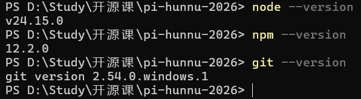
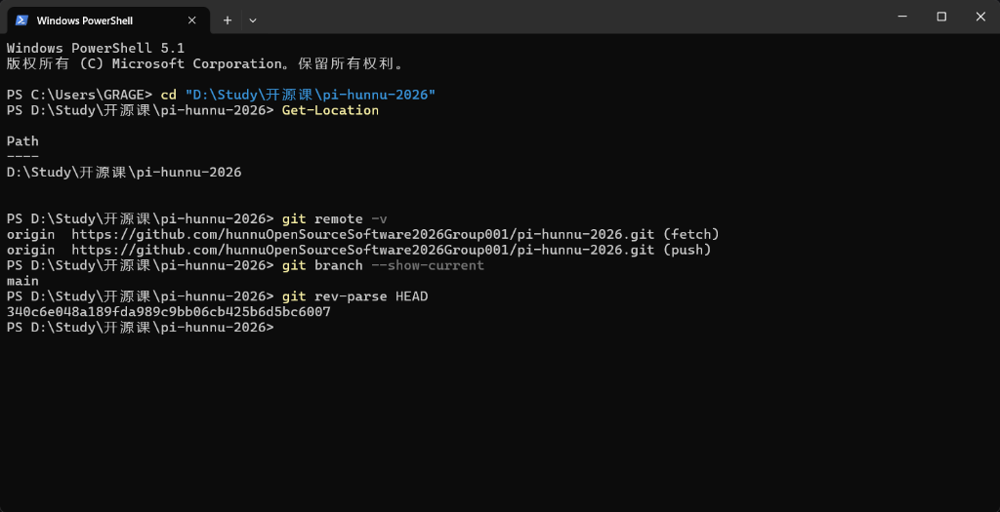
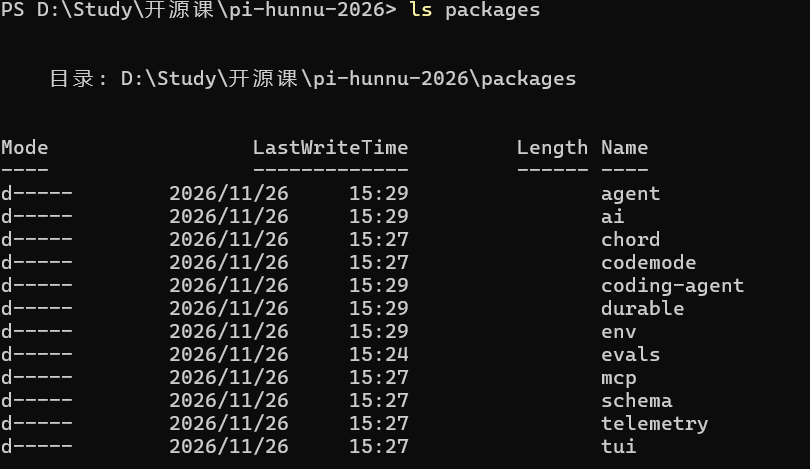
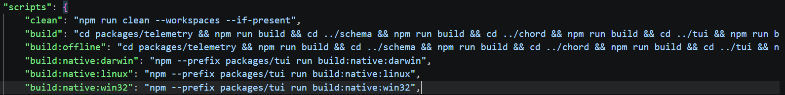
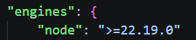
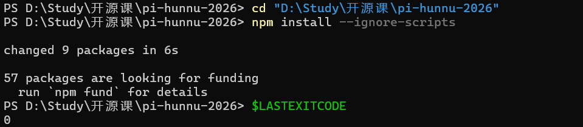
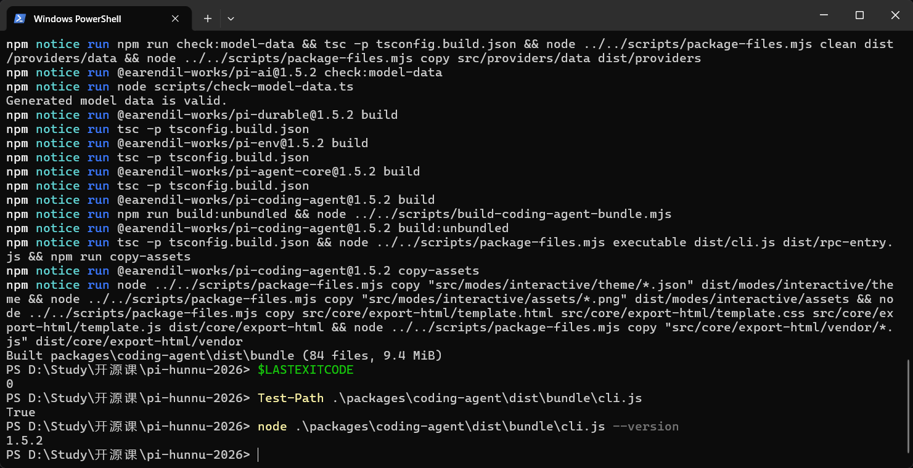
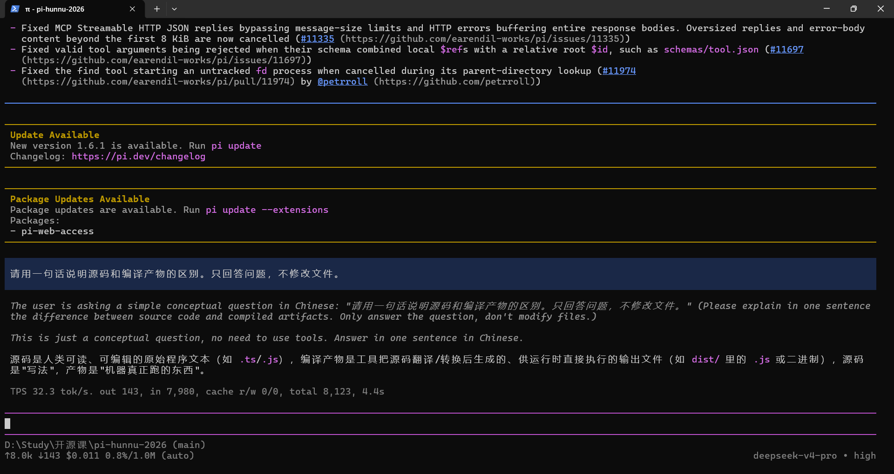

# 实践课 3：Pi Agent 源码获取、依赖安装与本地编译报告

- **姓名拼音**：`liushangkun`
- **Issue 标题**：`实践课3：Pi Agent源码安装与编译 liushangkun`
- **小组仓库地址**：`https://github.com/hunnuOpenSourceSoftware2026Group001/pi-hunnu-2026`
- **源码提交号（HEAD）**：`340c6e048a189fda989c9bb06cb425b6d5bc6007`（分支 `main`）

---

## 任务一：实验准备——检查开发工具版本

在 PowerShell 中依次检查 Node.js、npm 与 Git 版本：

```powershell
node --version
npm --version
git --version
```

实测结果：
- **Node.js**：`v24.15.0`（满足根 `package.json` 声明的 `>=22.19.0`，且符合课程建议的 Node.js 24 LTS，避免旧版 Node 22 下工作区依赖触发 `EBADENGINE`）
- **npm**：`12.2.0`
- **Git**：`git version 2.54.0.windows.1`



---

## 任务二：下载小组仓库源码并核对版本

从小组组织仓库克隆 `main` 分支并核对元信息：

```powershell
git clone --branch main https://github.com/hunnuOpenSourceSoftware2026Group001/pi-hunnu-2026.git
cd pi-hunnu-2026
Get-Location
git remote -v
git branch --show-current
git rev-parse HEAD
git status --short
```

实测结果：
- **源码目录**：`D:\Study\开源课\pi-hunnu-2026`
- **远端 `origin`**：`https://github.com/hunnuOpenSourceSoftware2026Group001/pi-hunnu-2026.git`
- **当前分支**：`main`
- **完整提交号**：`340c6e048a189fda989c9bb06cb425b6d5bc6007`





---

## 任务三：阅读配置，确认安装与编译依据

查看仓库根目录 `package.json` 与 `packages/coding-agent/package.json`：

1. **Node.js 版本要求在哪里？**
   在仓库根目录 `package.json` 第 69–71 行的 `engines.node` 字段中明确声明：
   ```json
   "engines": {
     "node": ">=22.19.0"
   }
   ```
2. **`npm run build` 实际从哪里读取命令？**
   从根目录 `package.json` 第 15 行的 `scripts.build` 读取。它使用 `&&` 依次进入 `packages/` 下的 11 个工作区子包（`telemetry` → `schema` → `chord` → `tui` → `codemode` → `mcp` → `ai` → `durable` → `env` → `agent` → `coding-agent`）并执行各自 `package.json` 里的 `scripts.build`。
3. **CLI 入口与工作区管理**：
   - 根目录通过 `workspaces` 统一管理多个子包，依赖统一安装在根目录 `node_modules` 并通过锁文件 `package-lock.json` 固定版本；
   - `packages/coding-agent/package.json` 中的 `"bin": { "pi": "./dist/bundle/cli.js" }` 定义了编译后的 CLI 入口。

**`scripts.build` 定义：**



**`engines.node` 定义：**



---

## 任务四：在仓库根目录安装项目依赖

在包含根 `package.json` 的目录 `d:\Study\开源课\pi-hunnu-2026` 下执行：

```powershell
npm install --ignore-scripts
```

### 命令作用说明
- 依据根 `package.json` 与 `package-lock.json` 统一解析、下载第三方依赖至根目录 `node_modules`，并建立 `packages/*` 内部工作区包的本地链接；
- 安装 TypeScript（`7.0.2`）、`esbuild`（`0.28.2`）、`@biomejs/biome` 等开发与构建工具；
- `--ignore-scripts` 跳过安装期间自动触发的生命周期钩子（如根 `package.json` 中的 `"prepare": "husky"` 或第三方包的 `postinstall`），提高安装安全性与可控性，不影响后续手动运行 `npm run build`；
- 不带 `-g`，只安装到当前项目，不会覆盖全局已安装的 `pi` 客户端（`1.5.0`）。

### 实测输出与警告分析
```text
npm warn deprecated prebuild-install@7.1.3: No longer maintained. Please contact the author of the relevant native addon; alternatives are available.
npm warn deprecated node-domexception@1.0.0: Use your platform's native DOMException instead

added 333 packages in 30s

57 packages are looking for funding
  run `npm fund` for details
```
- **退出码**：`0`（安装成功，共安装 333 个包，耗时 30s）。
- **警告与错误的区分**：上述两条 `npm warn deprecated` 只是上游间接依赖包已停止维护的提示，并非报错，不会导致安装失败；由于本机使用 Node.js `v24.15.0`，未出现 `EBADENGINE` 版本不兼容警告。



---

## 任务五：本地编译与构建产物验证

### 1. 首次构建
在仓库根目录执行：

```powershell
npm run build
```

实测过程与结果：
- 依次编译完成 `pi-telemetry`、`pi-schema`、`chord`、`pi-tui`、`pi-codemode`、`pi-mcp`；
- 在 `@earendil-works/pi-ai` 阶段联网执行 `node catalog/generate.ts --strict`，拉取 `models.dev`、NVIDIA NIM、OpenRouter、Vercel AI Gateway、Radius 等模型目录元数据（共统计 **1687 个支持工具调用的模型**、**1466 个支持推理的模型**），生成 `src/models.generated.ts` 和 `src/providers/data/` JSON 文件（注意：这是模型配置目录数据，**不是大模型权重**），校验通过（`Generated model data is valid.`）后完成 `tsc` 编译与数据复制；
- 继续完成 `pi-durable`、`pi-env`、`pi-agent-core` 与 `pi-coding-agent`（先 `build:unbundled` 输出 `dist/cli.js` 等，再通过 `esbuild` 生成打包产物：`Built packages\coding-agent\dist\bundle (84 files, 9.4 MiB)`）；
- **最终退出码**：`0`。

### 2. 构建产物验证
执行产物存在性与版本检查：

```powershell
Test-Path .\packages\coding-agent\dist\bundle\cli.js
# 输出：True
node .\packages\coding-agent\dist\bundle\cli.js --version
# 输出：1.5.2
```

- 入口文件 `.\packages\coding-agent\dist\bundle\cli.js` 存在且正常运行，版本号为 **`1.5.2`**（区别于实践课 1 全局安装的 `1.5.0`，直接证明运行的是本次本地源码编译产物）。
- 后续在不更新模型目录数据时，可使用 `npm run build:offline` 复用已生成的模型目录进行快速离线重编译（已验证离线重编译退出码 `0`）。



---

## 任务六：启动本地源码版本并验证

### 1. 验证源码入口
在仓库根目录执行：

```powershell
.\pi-test.bat --version
# 输出：1.5.2
```

### 2. 启动交互界面并完成一次会话
```powershell
.\pi-test.bat
```
发送测试问题：
```text
请用一句话说明源码和编译产物的区别。只回答问题，不修改文件。
```

### 3. 关键问题说明
- **本次如何确保运行的是本地源码？**
  1. 使用仓库根目录的 `.\pi-test.bat`（内部调用 `pi-test.ps1` 直接以 Node 运行 `packages/coding-agent/src/cli.ts`），而不是直接执行全局 `pi` 命令；
  2. 版本号对照验证：全局 `pi --version` 为 `1.5.0`，而 `.\pi-test.bat --version` 与 `node .\packages\coding-agent\dist\bundle\cli.js --version` 均为 `1.5.2`。
- **源码入口（`.\pi-test.bat`）与 `dist/bundle/cli.js` 入口分别适合什么场景？**
  - **源码入口（`.\pi-test.bat`）**：直接运行 `src/cli.ts`，适合开发调试期间快速验证代码改动，减少每次小改动后的打包等待；
  - **编译打包产物（`dist/bundle/cli.js`）**：经过完整 `tsc` 类型检查和 `esbuild` 打包合并，启动更快、不依赖源码转译环境，适合验证最终发布产物、性能测试与对外分发。

实测模型回复（`deepseek-v4-pro • high`）：
> 源码是人类可读、可编辑的原始程序文本（如 `.ts`/`.js`），编译产物是工具把源码翻译/转换后生成的、供运行时直接执行的输出文件（如 `dist/` 里的 `.js` 或二进制），源码是“写法”，产物是“机器真正跑的东西”。



---

## 任务七（重点）：遇到的问题与解决过程

### 问题 1：完整历史 `git clone` 下载极慢
- **现象**：首次执行 `git clone --branch main https://github.com/hunnuOpenSourceSoftware2026Group001/pi-hunnu-2026.git` 时，由于仓库历史对象多且直连 GitHub 带宽受限，长时间停留在接收阶段（2 分钟仅下载约 27 KB）。
- **分析**：本次实践课 2–5 仅需要 `main` 分支最新快照的完整工作树与 HEAD 提交号，不需要拉取全部历史提交对象。
- **解决**：清理未完成目录后改用浅克隆 `git clone --progress --depth 1 --branch main https://github.com/hunnuOpenSourceSoftware2026Group001/pi-hunnu-2026.git`，下载总量缩减至约 16.6 MiB 并顺利完成，且 `git remote -v`、`git branch --show-current`、`git rev-parse HEAD` 与后续编译完全不受影响。

### 问题 2：离线/无网络环境下首次 `npm run build` 在 `packages/ai` 失败
- **现象**：首次执行 `npm run build` 时，前 6 个子包均编译通过，但在 `@earendil-works/pi-ai` 的 `generate-models` 阶段报错：
  ```text
  Failed to fetch models.dev catalog: [TypeError: fetch failed]
  Error: getaddrinfo ENOTFOUND models.dev
  ```
- **分析**：查看 `packages/ai/package.json` 得知，首次 `build` 会调用 `node catalog/generate.ts --strict` 联网拉取 `models.dev` 等多方模型目录数据来生成 `src/models.generated.ts` 与 `src/providers/data/`；在无外网权限或网络受限环境中 DNS 解析失败。
- **解决**：在具备外网访问权限的终端环境下重新执行 `npm run build`，成功拉取并生成 1687 个模型配置数据，全部 11 个子包构建通过（退出码 `0`）；后续再次修改源码重编译时，则可使用 `npm run build:offline` 复用本地已生成的模型目录数据，不再依赖外网。

### 问题 3：安装日志出现 `npm warn deprecated` 提示
- **现象**：执行 `npm install --ignore-scripts` 时出现 `prebuild-install@7.1.3` 和 `node-domexception@1.0.0` 的弃用警告。
- **分析与处理**：核对退出码为 `0` 且 `node_modules` 完整生成，确认这属于上游间接依赖的弃用提示而非安装错误，按指导书要求不执行 `npm audit fix --force`，避免破坏课程锁定的依赖版本。
