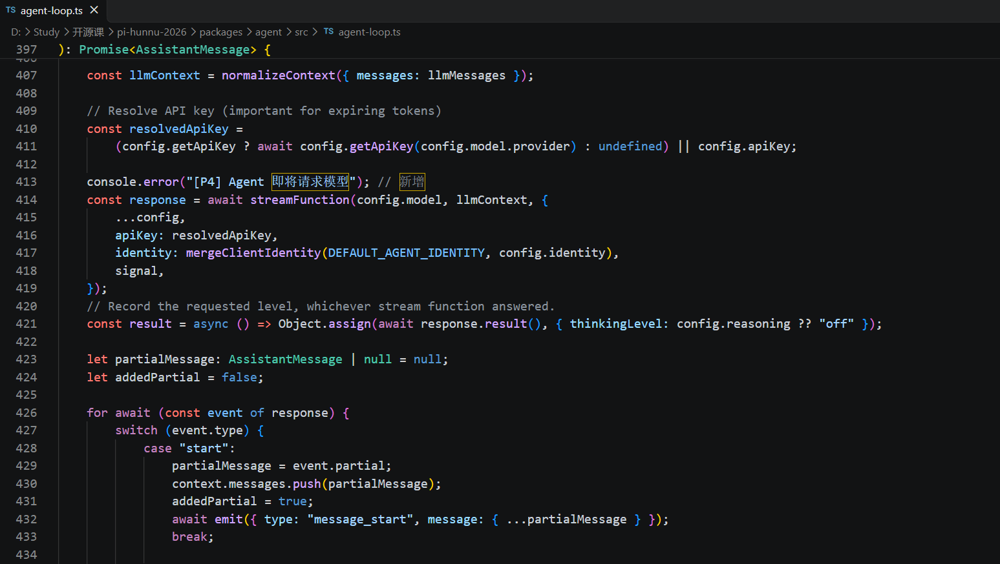
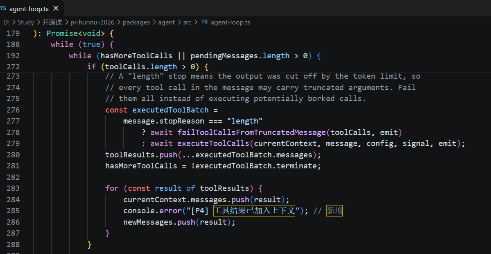
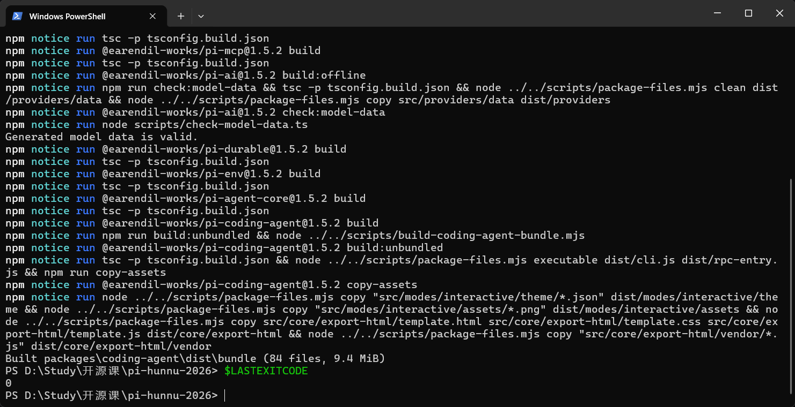
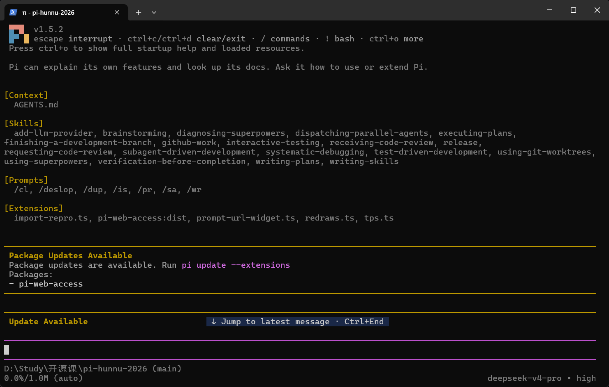
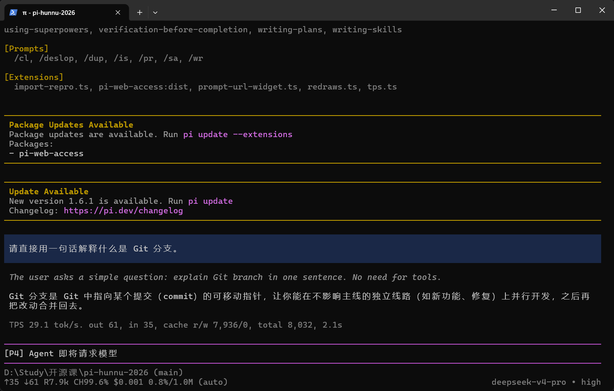
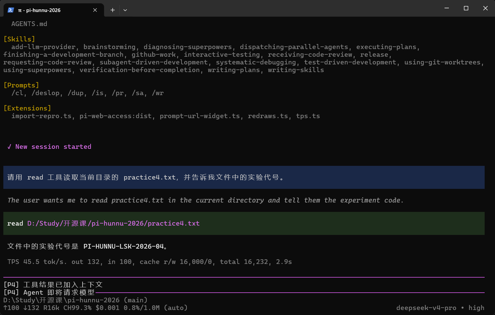
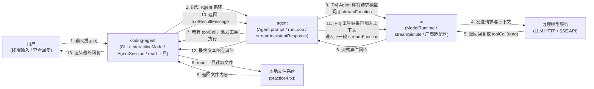

# 实践课 4：Pi Agent 的模型调用与运行流程报告

- **姓名拼音**：`liushangkun`
- **Issue 标题**：`实践课4：Pi Agent模型调用与运行流程 liushangkun`
- **小组仓库地址**：`https://github.com/hunnuOpenSourceSoftware2026Group001/pi-hunnu-2026`
- **基准提交号**：`340c6e048a189fda989c9bb06cb425b6d5bc6007`（仅在本地添加 `[P4]` 调试日志，未推送到小组远端仓库）

---

## 一、源码修改（`packages/agent/src/agent-loop.ts`）

在 `d:\Study\开源课\pi-hunnu-2026\packages\agent\src\agent-loop.ts` 中新增两处 `[P4]` `console.error` 日志：

1. **工具结果加入上下文之后**（位于 `runLoop()` 内，原第 284 行 `currentContext.messages.push(result);` 下方，新增于第 285 行）
2. **模型调用发起之前**（位于 `streamAssistantResponse()` 内，原第 412 行 `const response = await streamFunction(...)` 上方，新增于第 413 行）

实测 `git diff packages/agent/src/agent-loop.ts`：

```diff
diff --git a/packages/agent/src/agent-loop.ts b/packages/agent/src/agent-loop.ts
index 24497b2..1260cb7 100644
--- a/packages/agent/src/agent-loop.ts
+++ b/packages/agent/src/agent-loop.ts
@@ -282,6 +282,7 @@ async function runLoop(
 
 				for (const result of toolResults) {
 					currentContext.messages.push(result);
+					console.error("[P4] 工具结果已加入上下文"); // 新增
 					newMessages.push(result);
 				}
 			}
@@ -409,6 +410,7 @@ async function streamAssistantResponse(
 	const resolvedApiKey =
 		(config.getApiKey ? await config.getApiKey(config.model.provider) : undefined) || config.apiKey;
 
+	console.error("[P4] Agent 即将请求模型"); // 新增
 	const response = await streamFunction(config.model, llmContext, {
 		...config,
 		apiKey: resolvedApiKey,
```

**截图 S1（第 413 行：`streamFunction` 上方新增 `[P4] Agent 即将请求模型`）：**



**截图 S2（第 285 行：`currentContext.messages.push(result)` 下方新增 `[P4] 工具结果已加入上下文`）：**



---

## 二、重新编译与启动验证

在仓库根目录 `d:\Study\开源课\pi-hunnu-2026` 执行重编译（首次已构建模型数据，本次验证离线重编译成功；若按指导书重新执行 `npm run build` 同样通过）：

```powershell
cd d:\Study\开源课\pi-hunnu-2026
npm run build:offline   # 或 npm run build
$LASTEXITCODE
```

实测结果：
- 11 个子包全部编译通过，`@earendil-works/pi-agent-core` 与 `@earendil-works/pi-coding-agent` 均已重新生成产物（`Built packages\coding-agent\dist\bundle (84 files, 9.4 MiB)`）；
- 退出码 `$LASTEXITCODE` = **`0`**。

启动编译产物命令：

```powershell
node .\packages\coding-agent\dist\cli.js
```

**截图 S3（重新编译完成及退出码 `0`）：**



**截图 S4（启动编译产物 `node .\packages\coding-agent\dist\cli.js` 打开 Pi 交互界面）：**



---

## 三、两次运行对比（会话 A vs 会话 B）

已在项目根目录创建实验文件 [practice4.txt](file:///d:/Study/开源课/pi-hunnu-2026/practice4.txt)，内容为自定实验代号：

```text
PI-HUNNU-LSK-2026-04
```

### 对比记录表

| 项目 | 会话 A（直接问答） | 会话 B（读取文件） |
|---|---|---|
| 使用模型 | `deepseek-v4-pro • high` | `deepseek-v4-pro • high` |
| 输入给 Pi 的指令 | `请直接用一句话解释什么是 Git 分支。` | `请用 read 工具读取当前目录的 practice4.txt，并告诉我文件中的实验代号。` |
| 是否调用工具 | 否（无工具调用） | 是（调用 `read` 工具读取 `D:/Study/开源课/pi-hunnu-2026/practice4.txt`） |
| 按顺序出现的 `[P4]` 日志（实测观察） | 1. `[P4] Agent 即将请求模型` | 1. `[P4] Agent 即将请求模型`（第 1 轮发起，被 TUI 重绘刷过）<br/>2. `[P4] 工具结果已加入上下文`<br/>3. `[P4] Agent 即将请求模型`（第 2 轮基于工具结果请求模型） |
| 进入的模型调用轮数 | **1 轮** | **2 轮**（第 1 轮模型决定调用 `read`；第 2 轮基于工具结果生成最终回答） |
| Pi 最终回复 | `Git 分支是 Git 中指向某个提交（commit）的可移动指针，让你在不影响主线的独立线路（如新功能、修复）上并行开发，之后再把改动合并回去。` | `文件中的实验代号是 PI-HUNNU-LSK-2026-04。` |

**截图 S5（会话 A：直接问答，仅 1 条 `[P4] Agent 即将请求模型`，无工具调用）：**



**截图 S6（会话 B：调用 `read` 读取 `practice4.txt`，准确返回 `PI-HUNNU-LSK-2026-04`，并依次输出 `[P4] 工具结果已加入上下文` 与 `[P4] Agent 即将请求模型`）：**



---

## 四、运行流程原理解析

结合源码与会话 B 的日志顺序分析：

1. **两次分别进入了几轮模型调用？**
   - **会话 A（直接问答）**：仅进入 **1 轮**模型调用。第 1 轮模型直接返回文本回答，`message.content` 中不含 `toolCall`，`hasMoreToolCalls` 为 `false`，`runLoop` 直接结束。
   - **会话 B（读取文件）**：进入 **2 轮**模型调用。第 1 轮模型无法直接看到本地文件内容，只返回了一条 `read("practice4.txt")` 的 `toolCall` 请求；工具执行完毕后 `hasMoreToolCalls` 为 `true`，循环进入第 2 轮，再次调用 `streamAssistantResponse` 请求模型，模型看到文件内容后才输出包含实验代号 `PI-HUNNU-LSK-2026-04` 的最终回复。
2. **谁实际读了文件？**
   - **不是远程大模型**，而是本地 `coding-agent` 进程中的 `read` 工具（`packages/coding-agent/src/core/tools/read.ts`）通过 Node.js 文件系统 API 读取了本地的 `practice4.txt`。远程模型只负责根据上下文决策“需要调用哪个工具、传什么参数”，并不直接接触用户电脑的硬盘。
3. **下一轮模型请求多带了什么？**
   - 相比第 1 轮请求，第 2 轮送给模型的 `currentContext.messages` 里**多出了两条消息**：
     1. 第 1 轮模型自己生成的包含 `toolCall`（调用 `read`）的 `AssistantMessage`；
     2. 本地 `read` 工具执行完后，由 `currentContext.messages.push(result)` 写入上下文的 `ToolResultMessage`（里面携带着 `practice4.txt` 的实际内容 `PI-HUNNU-LSK-2026-04`）。

### 调用链与模块协作简图

可编辑图源：[practice-04-flow.mmd](file:///d:/Study/开源课/my-practice-reports/diagrams/practice-04-flow.mmd)


