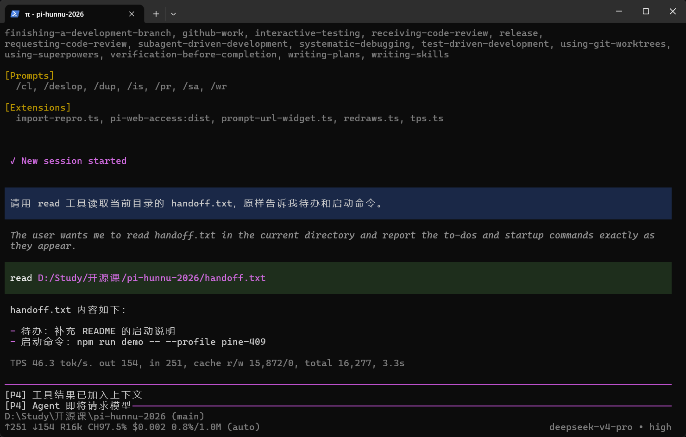
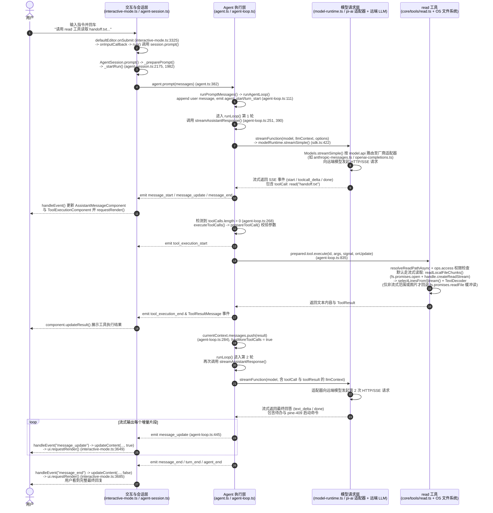
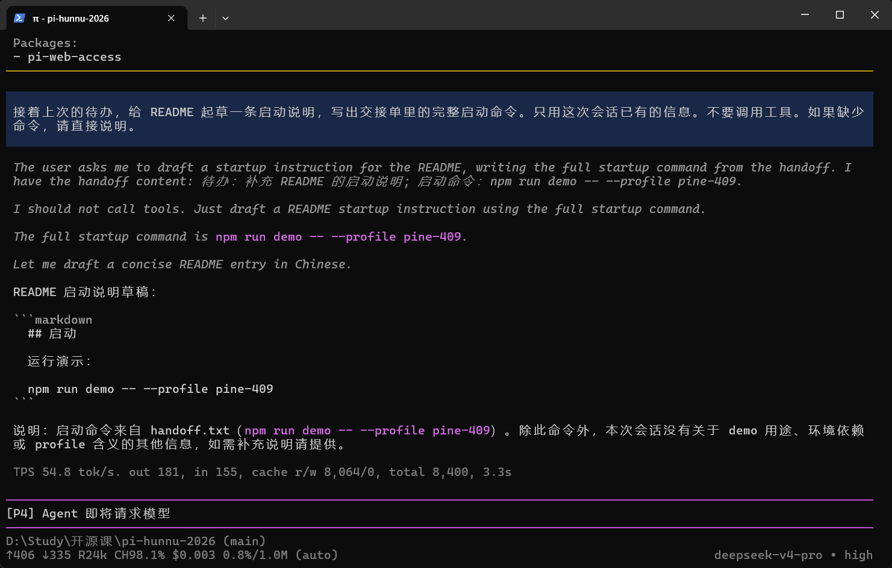
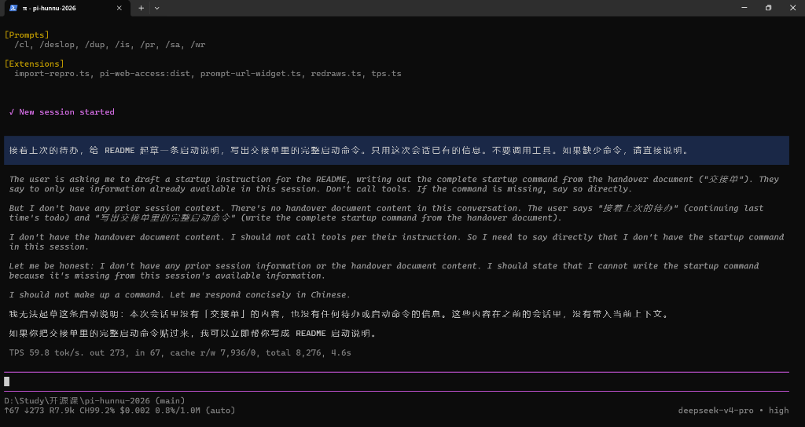
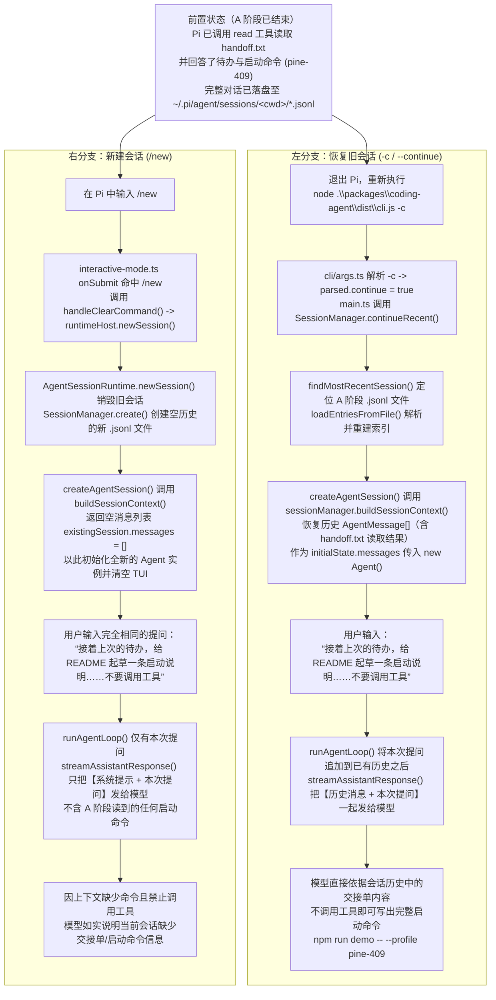

# 实践课 5：Pi Agent 源码泛读与功能定位报告

- **姓名拼音**：`liushangkun`
- **Issue 标题**：`实践课5：Pi Agent工具调用与会话恢复 liushangkun`
- **小组仓库地址**：`https://github.com/hunnuOpenSourceSoftware2026Group001/pi-hunnu-2026`
- **源码版本（HEAD）**：`340c6e048a189fda989c9bb06cb425b6d5bc6007`

---

## A. 单轮交互与工具调用（读取 `handoff.txt`）

### 1. 实验准备与操作
已在项目根目录创建 [handoff.txt](file:///d:/Study/开源课/pi-hunnu-2026/handoff.txt)，写入自定随机标识 `pine-409`：

```text
待办：补充 README 的启动说明
启动命令：npm run demo -- --profile pine-409
```

启动本地构建的 Pi（`node .\packages\coding-agent\dist\cli.js`），在新会话中输入：

> 请用 read 工具读取当前目录的 handoff.txt，原样告诉我待办和启动命令。

实测结果：Pi 调用 `read D:/Study/开源课/pi-hunnu-2026/handoff.txt`，原样返回了待办与启动命令 `npm run demo -- --profile pine-409`，底部 `[P4]` 日志清晰展示了工具结果回填上下文并触发第 2 轮模型请求的完整循环：



### 2. 源码关键位置核查（含 `read` 工具流式 vs 缓冲区核对）
- **输入入口**：`packages/coding-agent/src/modes/interactive/interactive-mode.ts`
  - `setupEditorSubmitHandler()`（L3324–3523）注册 `this.defaultEditor.onSubmit`（L3325）；
  - 普通输入触发 `this.onInputCallback(text)`（L3516–3520），驱动 `InteractiveMode.run()`（L1293–1301）调用 `this.session.prompt(userInput)`（L1296）；
  - `AgentSession.prompt()`（`packages/coding-agent/src/core/agent-session.ts:2175`）经 `_preparePrompt()` 后在 `_startRun()`（L1982）调用 `this.agent.prompt(messages)`。
- **启动循环与工具调度**：
  - `packages/agent/src/agent.ts`：`Agent.prompt()`（L382）→ `runPromptMessages()`（L441）→ `runAgentLoop()`（`packages/agent/src/agent-loop.ts:111`）→ `runLoop()`（L172）；
  - 第 1 轮调用 `streamAssistantResponse()`（L251, L390），将 `AgentMessage[]` 转为 `Message[]` 后调用 `streamFunction(config.model, llmContext, ...)`（L412）；
  - 检测到 `toolCalls.length > 0`（L268）后调用 `executeToolCalls()`（L279）→ `prepareToolCall()`（L708，参数校验）→ `executePreparedToolCall()`（L824，调用 `prepared.tool.execute(...)`）；
  - 将工具结果 `ToolResultMessage` 压入 `currentContext.messages.push(result)`（L284），随后 `hasMoreToolCalls = true`，回到 `runLoop()` 发起第 2 轮模型请求。
- **模型请求层边界**：
  - `packages/coding-agent/src/core/sdk.ts`（L422）调用 `modelRuntime.streamSimple(...)`；
  - `packages/coding-agent/src/core/model-runtime.ts`（L744–781）准备鉴权后调用 `prepared.provider.streamSimple(...)`；
  - `packages/ai/src/models.ts`（L958）按 `model.api` 分发至具体厂商适配器（如 `packages/ai/src/api/anthropic-messages.ts:808,885` 或 `openai-completions.ts:312,385`），由适配器向远端 LLM 发起 HTTP/SSE 请求并产出流式事件。
- **`read` 工具底层读取方式核实（流式 vs 缓冲区）**：
  - 源码位置：`packages/coding-agent/src/core/tools/read.ts`（`createReadToolDefinition`，L229–359）；
  - 默认 `defaultReadOperations`（L68–73）同时提供 `createReadStream: readLocalFileChunks`（L81–92，使用 `fs/promises` 的 `open(path, "r")` + `handle.createReadStream()`）和 `readFile: fsReadFile`；
  - 读取普通文本文件 `handoff.txt` 时（L300–308），条件 `ops.createReadStream && isStreamableRange(offset, limit)` 为真，**实际走的是流式读取** `selectLinesFromStream()`（L142–227），分块用 `TextDecoder("utf-8", { ignoreBOM: true })` 解码并配合 `truncateHead` 控制内存占用；
  - 只有在自定义操作未提供 `createReadStream`、使用了非流式范围（如小数 offset 或负数 limit），或者读取图片文件（L277）时，才会回退到 `fs.promises.readFile` 的整文件缓冲区读取（`selectLinesFromBuffer`，L130–136）。
- **显示回复**：
  - 回到 `packages/coding-agent/src/modes/interactive/interactive-mode.ts`，`subscribeToAgent()`（L3525）订阅会话事件并交给 `handleEvent()`（L3531）；
  - `case "message_start"`（L3625）创建 `AssistantMessageComponent`；
  - `case "message_update"`（L3649）调用 `streamingComponent.updateContent(streamingMessage, true)` 与 `this.ui.requestRender()`，实时流式刷新文本和 `ToolExecutionComponent`；
  - `case "message_end"`（L3685）调用 `streamingComponent.updateContent(streamingMessage, false)` 定稿并刷新页脚与界面，用户在此看到完整回复。

### 图 1：单轮工具调用的代码级时序图

可编辑图源：[practice-05-seq-tool-call.mmd](file:///d:/Study/开源课/my-practice-reports/diagrams/practice-05-seq-tool-call.mmd)



---

## B. 恢复上次会话（`-c`）与新建会话（`/new`）对照

### 1. 实验步骤与实测对照表
在 A 阶段已经读完 `handoff.txt` 并回答后，执行两组对比测试，输入完全相同的指令：

> 接着上次的待办，给 README 起草一条启动说明，写出交接单里的完整启动命令。只用这次会话已有的信息。不要调用工具。如果缺少命令，请直接说明。

| 对比维度 | 左分支：恢复旧会话（`-c`） | 右分支：新建会话（`/new`） |
|---|---|---|
| 启动/切换方式 | 退出后执行 `node .\packages\coding-agent\dist\cli.js -c` | 在 Pi 内输入 `/new` 开启新会话 |
| 终端是否可见 A 阶段记录 | 是（恢复出 A 阶段对话记录） | 否（聊天界面清空，提示 `✓ New session started`） |
| 是否调用工具 | 否（未重新读文件，仅触发 1 次 `[P4] Agent 即将请求模型`） | 否（未调用工具） |
| 实测回答记录 | 直接起草了 README 的 `## 启动` 说明并准确写出完整启动命令 `npm run demo -- --profile pine-409`，且注明“启动命令来自 `handoff.txt`”，证明完整复用了已恢复的会话历史 | 回复：“我无法起草这条启动说明：本次会话中没有「交接单」的内容，也没有任何待办或启动命令的信息。这些内容在之前的会话中，没有带入当前上下文。”证明新会话历史为空 |

**左分支（`-c` 恢复旧会话）实测截图：**



**右分支（`/new` 新建会话）实测截图：**



### 2. 源码级机制对照
两条路径最终都汇合到 `packages/coding-agent/src/core/sdk.ts` 的 `createAgentSession()`（L210 与 L403–410），核心差异在于 `sessionManager.buildSessionContext()` 返回的 `existingSession.messages`：

- **恢复旧会话（`-c` / `--continue`）**：
  1. `packages/coding-agent/src/cli/args.ts`（L111–112）将 `-c` / `--continue` 解析为 `parsed.continue = true`；
  2. `packages/coding-agent/src/main.ts`（L479–481）调用 `SessionManager.continueRecent(cwd, sessionDir)`；
  3. `packages/coding-agent/src/core/session-manager.ts`（L1811–1819）通过 `findMostRecentSession()` 找到 `~/.pi/agent/sessions/<encoded-cwd>/` 下最近的 `.jsonl` 会话文件，由 `loadEntriesFromFile()`（L628–660）分块读取并逐行 `JSON.parse`，通过 `_buildIndex()`（L1111）重建消息树；
  4. `sessionManager.buildSessionContext()`（L1515）沿 `leafId` 到根节点投影出完整历史 `AgentMessage[]`，作为 `initialState.messages` 传给 `new Agent(...)`（`sdk.ts:403`）。用户再次提问时，历史消息与新提问一起被送入 `streamFunction`。
- **新建会话（`/new`）**：
  1. `packages/coding-agent/src/modes/interactive/interactive-mode.ts`（L3429–3433）在 `onSubmit` 中截获 `/new`，调用 `handleClearCommand()`（L7117）→ `runtimeHost.newSession()`；
  2. `packages/coding-agent/src/core/agent-session-runtime.ts`（L226–260）销毁旧 `AgentSession`，调用 `SessionManager.create()` 新建仅含 header 的空 `.jsonl` 会话（`session-manager.ts:1065–1091`）；
  3. `createAgentSession()` 得到的 `existingSession.messages` 为空数组 `[]`，据此初始化全新 `Agent` 并通过 `rebindSession` 清空 TUI；因此用户输入相同问题时，发往模型的上下文里不包含 A 阶段的任何历史消息。

### 图 2：恢复旧会话和新建会话的对照图

可编辑图源：[practice-05-session-compare.mmd](file:///d:/Study/开源课/my-practice-reports/diagrams/practice-05-session-compare.mmd)


